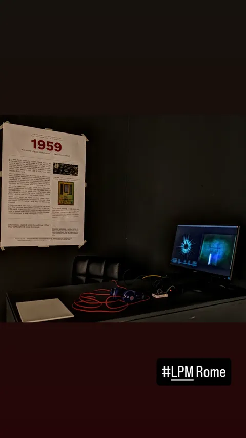

# `1959` — the film and the die, in one window

In 1959 David Hubel and Torsten Wiesel lowered an electrode into the visual
cortex of a cat and moved a bar of light across its field of view. A single
neuron answered, and its spikes were audible as clicks on tape.

This app plays that recording into a fabricated SkyWater 130 nm die containing
sixteen analog spiking neurons. Every click the detector finds on the tape
becomes one spike delivered to **neuron 14** through its excitatory synapse.
The neuron's membrane comes back on the analog monitor pin, and that is the
picture on the left. The film is on the right. The visitor hears both: the
cat's cortex in one ear and the silicon in the other, sixty-seven years apart,
almost in unison.

One window, one thing to start.

```
   left half                                right half
   ┌──────────────────────────┐   ┌──────────────────────────┐
   │   the die's membrane,    │   │   the 1959 film, whose   │
   │   spiral + scope strip   │   │   soundtrack is driving  │
   │   (coro-pixhawk's        │   │   the die                │
   │    picture, verbatim)    │   │                          │
   └──────────────────────────┘   └──────────────────────────┘
      sound: left = the tape          sound: right = the die
```

<p align="center"></p>

The story of the piece — the cat, the synapses, the layout, the concept — is
also a two-minute film in this repository:
[`video/1959_master_1080p.mp4`](video/1959_master_1080p.mp4) (narrated,
subtitled; a silent venue loop builds from it with `make -C video loop`).

## Running it

```bash
./prepare.sh                  # once: provision video.mp4 + audio.s16
make -j$(nproc)
cd bin && ./ofxLPM-1959
```

Before launching, in this order:

1. **Bring the chip up:** `./flash_exhibition.sh`

   One command. It flashes the image pinned in
   `tools/firmware/neuron_handshake/` — verifying its sha256 first — and clocks
   the die to 25 MHz, leaving the DACs alone. Use `--with-dac` only if you want
   the default bias pass, which resets all 23 channels and clobbers tuned biases.

   Do **not** flash whatever is in the main `firmware/` build tree instead: it
   moves with development, and its input pulse width differs. Charge per input
   spike is `I_syn × pulse_width`, so that changes how the array responds. See
   `tools/firmware/neuron_handshake/README.md` for the measured widths.

   `CARAVAN_CLK_MHZ` must be 25 for this app and its bridge. The DLL does not
   survive a power cycle, so rerun the script after unplugging.
2. **Free the FTDI.** `pkill -f "[n]euron_bridge.py"`, and close the GUI. Only
   one process may own it, and this app spawns its own bridge.
3. **Plug the ADC board in.** `/dev/ttyACM0` by default. The app reopens the
   port on its own if it is not there yet or goes away mid-run.

Once running it brings the die up by itself, in stages, and says so on screen
until the room is going:

```
biases (bias_n14_lpm_v1.biases)  →  monitor N14  →  PROG S14/S0 W15 exc
   →  ROUTE S0 → N14 exc  →  stimulation
```

It waits for `neuron_bridge.py` to say `READY` before it touches a DAC, and
`PROG` always precedes `ROUTE` — programming a weight re-runs `spikesetup` on
the chip and clobbers whatever route was staged.

Two synapses are programmed, one is fired: `chipProgSyn` (14) is the bench
sequence as it is written down, `chipSynapse` (0) is the one actually routed
and fired. Weighting only the first would fire an unweighted synapse and the
neuron would sit there silent.

## The die on the other side of the network

The die and the ADC board do not have to be on the machine that draws the
picture. `remoteChip` in `settings.json` is a host and three ports; set it and
the app spawns no bridge and opens no serial port, taking both streams over TCP
instead. `tools/chip_server.py` is the other end: it owns the FTDI and the ADC
on the plinth machine and relays three things.

| port | direction | carries |
|---|---|---|
| 9100 | plinth → app | `neuron_bridge.py` stdout: `READY`, `S <n> <us>`, `RATE`, `BOK`/`MOK`/`POK`/`SOK` |
| 9101 | plinth → app | `seconds,volts` from the ADC board, at the board's own rate. Two-channel firmware sends `seconds,ch1,ch2`; the relay forwards lines whole and the app reads channel 1 |
| 9102 | app → plinth | anything the app would have written to the bridge's stdin |

The plinth machine here is a Raspberry Pi 5 (Debian 13, aarch64) at
`192.168.1.48`, with the FT4232H and the Pixhawk both on its USB. It carries
`~/chip1959`:

```
~/chip1959/
  tools/           rsync of this repo's tools/ (bridge, chip_server, pinned hex,
                   and systemd/ -- the rules and the unit below)
  run_neuron_test.py    from the chip repo root -- the flasher
  firmware -> tools/firmware   so run_neuron_test.py finds riscvprog.py
  .venv/           python3 -m venv --system-site-packages; pip install pyftdi
```

### The devices start it, and stop it

There is no command to run on the plinth. `tools/systemd/install.sh`, run once,
lays down a udev rules file and a service unit, and after that the two cables
are the switch: plug the die and the scope in and the stream comes up on
9100/9101/9102, unplug either and it goes away.

The service **binds to both devices** (`BindsTo=`), so losing one is a clean
stop rather than a half-served link, and udev's `SYSTEMD_WANTS` starts it again
when they are back — at boot as well, since udev coldplugs what is already
plugged in. There is nothing to `systemctl enable`; enabling it would start it
at boot with no chip attached, which is the opposite of what is wanted.

Two details in the rules are load bearing:

- The die is depended on by its **raw USB node** (`/dev/chip-ftdi`), not by a
  `ttyUSB*`. pyftdi drives the FT4232H through libusb and detaches `ftdi_sio`
  from every interface it takes, so the `ttyUSB*` nodes disappear as soon as the
  bridge starts. A service bound to one of those would stop itself.
- Both devices get a stable symlink (`/dev/chip-ftdi`, `/dev/chip-scope`), so
  the unit does not care whether the scope came up as `ttyACM0` or `ttyACM1`,
  and the server is pointed at `/dev/chip-scope`.

Starting takes about twenty-five seconds, because the service flashes before it
serves: the DLL does not survive a power cycle, so every start puts the pinned
image on the die over its bare crystal and then clocks it to 25 MHz. The ports
do not open until that is done.

```bash
systemctl status chip1959        # is it up
journalctl -u chip1959 -f        # what it is saying
sudo systemctl restart chip1959  # reflash and re-serve by hand
sudo systemctl stop chip1959     # free the FTDI for bench work
```

A stop by hand stays stopped until a device is replugged, which is what you
want when you need the FTDI for something else.

Then, on the machine with the projector:

```bash
# bin/data/settings.json
"remoteChip": "192.168.1.48:9100:9101:9102"
cd bin && ./ofxLPM-1959
```

`settings.json_remote` and `settings.json_local` are the two presets; copy one
over `settings.json`. Before launching, the link can be read directly:

```bash
nc 192.168.1.48 9101 | head      # seconds,volts at the board's rate
nc 192.168.1.48 9100 | head      # S/RATE lines off the array
```

Nothing about the piece changes across the network. The bring-up still stages
biases → monitor → PROG → ROUTE, the self-healing sentinel still walks
`JExcWn0`, and the ratio still settles to 1:1 — measured over this link at 87
triggers to 88 spikes back from N14.

### The app dials, and keeps dialling

`NetworkBridge` owns the reconnect, so the app never has to be relaunched to
follow the plinth. It starts its thread whether or not the first connection
worked, retries with a backoff from 0.5 s to 4 s, and notices the far end
going away — `read()` returning 0, which is the only way TCP says so, told
apart from the `EAGAIN` of a socket that is merely idle. Commands go out with
`MSG_NOSIGNAL`: writing to a socket the far end has closed raises `SIGPIPE`,
and the default action for that is to kill the process.

**A link that comes back is a chip that has been brought back.** The service
reflashes the die every time it starts, so it is listening with no weights, no
route, and a Timer0 counting from zero. `consumeReconnect()` tells the app,
which stages the whole bring-up again rather than talking to a chip that is no
longer set up, and clears the AER accounting with it — the high-water timestamp
especially, which would otherwise sit in the future of the restarted counter and
make every new spike look old. The sentinel also holds still while the link is
down, instead of reading the missing spikes as a bias that needs raising.

Measured, pulling the die's cable with the piece running: the link drops, the
service stops, and on replug the app reconnects, re-stages the bring-up, and is
back at 72 triggers to 72 spikes — with nothing touched at either end.

## Keys

| | |
|---|---|---|
| `-` `=` | chip channel level, logged so it can be written back to `settings.json` |
| `↑` `↓` | scope gain |
| `←` `→` | membrane detector threshold (logs the resulting rate) |
| `,` `.` | film detector threshold (logs the resulting rate) |
| `[` `]` | spiral period |
| `V` | flip the scope trace |
| `R` | right channel only (chip ticks) |
| `L` | left channel only (film soundtrack) |
| `B` | both channels (default) |
| space | pause film and video; the die stops being stimulated |
| type `cal` | the full calibration overlay |
| type `quit` | exit (Escape is disabled) |

`settings.json` is re-read within a second of being saved, so most of it can be
set by ear or by eye with the piece running.

## The three paths

Three devices, three separate links:

| | |
|---|---|
| FTDI | `neuron_bridge.py` — UART commands out, AER spike stream back |
| `/dev/ttyACM0` | the monitor pin, sampled at **1 kHz** by a Pixhawk 2.4.8 (STM32F427) and streamed as `seconds,volts` over USB CDC. The two-channel build of that firmware appends a third field; this app is single-channel and ignores it |
| sound card | the tape out on the left, the ticks the measured resets strike on the right |

The board's rate is load bearing: it sets the spiral's timebase and the
detector's follower. The app measures the arriving line rate every five seconds
and logs `board confirmed at 1000 Hz` once, or warns every window while it
disagrees with `deviceRateHz` by more than 15%. The board firmware is
currently 1 kHz; earlier images were 400 Hz, and `traceAlphaQuiet` has to be
rescaled inversely with the rate (0.12 at 400 Hz, 0.048 at 1 kHz).

## Where the code comes from

This repository is self-contained on purpose — it runs on its own rather than
only on the bench it was written on — but most of it is not original to it, and
the originals are where it is maintained:

| | |
|---|---|
| `src/Detector.h`, `RingBuffer.h`, `Settings.h` | the installation's signal path, from `ofxLPM/coro/src`. The detector is not a reimplementation: it is the same code that drives the gallery piece next door. |
| `src/NeuronBridge.{h,cpp}` | the FTDI child process and its pipe protocol, from the chip viewer. |
| `tools/neuron_bridge.py`, `tools/firmware/riscvprog.py` | the driver itself — DLL, DACs, UART, AER. See [`tools/README.md`](tools/README.md). |

All are verbatim copies, so a `diff` against the originals shows only real
drift. `src/HubelDetector.h` is the one line that is not: a shim renaming the
detector's `SpikeEvent` to `HubelSpikeEvent`, because `NeuronBridge.h` has a
`SpikeEvent` of its own — the AER address stream.

Edit `OF_ROOT` in `config.make` if openFrameworks does not live where mine
does. `pip install pyftdi` for the chip side.

## Self-healing

Every 15 s the app compares TRIGs sent to the chip against AER spikes received
back from the monitored neuron. If the ratio drifts from 1:1, it adjusts the
excitatory synapse bias (`JExcWn0`) with an adaptive step (1–10 mV, larger when
further from target). The sentinel and recovery run entirely in software on the
host, using the same bias commands the GUI uses. The calibration overlay (type
`cal`) shows the current ratio, bias voltage, and action count.

## Without the chip, or without the film

- `"chipEnabled": false` runs the picture and the sound with the die untouched:
  no bridge is spawned, no DAC is written, nothing takes the FTDI. For testing
  the projection and the speakers, and for leaving the bench free while you do.
- `"tickSource": "aer"` strikes the tick from the chip's own digital report of
  each spike instead of the analog reset, which keeps the right channel alive
  if the ADC board is not connected. `"both"` strikes on either.
- `bin/data/video.mp4` (3.6 MB, *Hubel & Wiesel 2 — Cat Experiment*, 1959)
  and `bin/data/audio.s16` (19 MB, the PCM of its soundtrack) are in git, so
  the piece runs out of the box; the film's credit stands as on the poster and
  in the story film. `./prepare.sh` still decodes the PCM beside the film if
  you bring your own copy instead.
